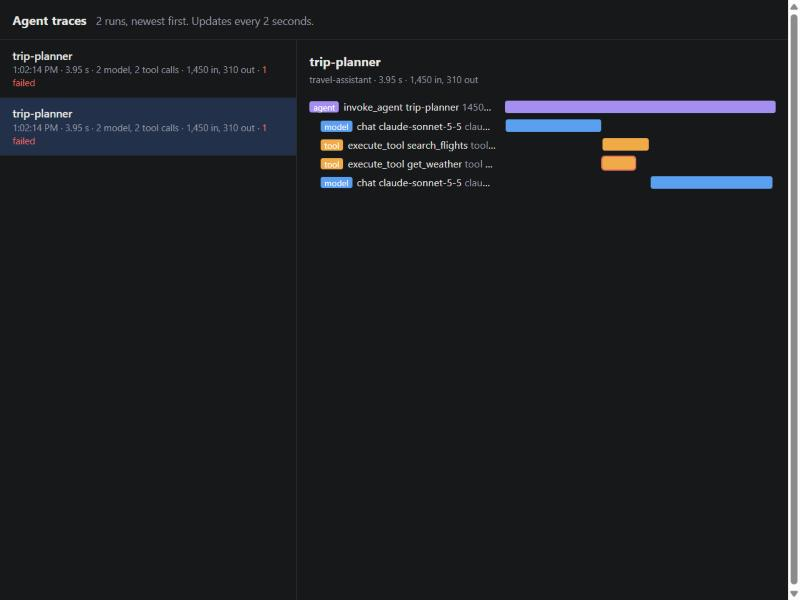

# agent-trace-viewer

[](https://github.com/Urthella/agent-trace-viewer/actions/workflows/ci.yml)

A local viewer for AI agent traces. Point your app's OpenTelemetry exporter at it, and it shows
each agent run: its model calls and tool calls on a timeline, which ones failed, and the tokens
used. It reads the attributes in OpenTelemetry's
[GenAI conventions](https://github.com/open-telemetry/semantic-conventions-genai), such as
`gen_ai.operation.name`, `gen_ai.request.model` and `gen_ai.usage.input_tokens`, from any
instrumentation that follows them. Node only, no dependencies.



## Run it

```bash
git clone https://github.com/Urthella/agent-trace-viewer && cd agent-trace-viewer
node src/main.ts
```

Then run your app with:

```bash
OTEL_EXPORTER_OTLP_ENDPOINT=http://localhost:4318
OTEL_EXPORTER_OTLP_PROTOCOL=http/json
```

and open http://localhost:4318. To see it work without an app, `npm install` and
`node scripts/demo.ts` sends a made-up agent run through the real OpenTelemetry SDK.

It listens on 127.0.0.1, port 4318, the usual one for OTLP over HTTP. `--port`, `--host`,
`--max-traces` and `--max-spans` change that.

## What it shows

Each span is sorted by its `gen_ai.operation.name`:

| Kind | Operations |
| --- | --- |
| agent | `invoke_agent`, `create_agent`, `invoke_workflow`, `invoke_runner` |
| model | `chat`, `generate_content`, `text_completion`, `realtime_inference`, `embeddings` |
| tool | `execute_tool` |
| other | anything else, including spans that aren't GenAI at all |

For each run it shows the agent's name, how long it took, how many model and tool calls it made,
how many failed, and the tokens in and out. For each call it shows the model (the one that
answered, else the one asked for), the provider, the tool, and its own tokens.

**Tokens are counted once.** An `invoke_agent` span may report token totals for its whole run,
and its model calls report their own, so adding up every span would count the same tokens twice.
The run's total comes from the model calls. Agent totals are used only when no model call reports
any, and then only from agents that aren't inside another agent.

## Contents

Click a call marked ▸ to see what it sent and got back: tool arguments and results, input and
output messages, system instructions and finish reasons. These are in the GenAI conventions as
`gen_ai.tool.call.arguments`, `gen_ai.input.messages` and so on, and are often recorded as JSON in
a string, which is shown parsed.

Instrumentations record contents only when told to, since they can hold anything a user typed.
They stay on your machine: the viewer keeps them in memory and sends nothing anywhere.

## Limits

- **JSON only.** OTLP over HTTP defaults to protobuf in most SDKs, so set
  `OTEL_EXPORTER_OTLP_PROTOCOL=http/json`. A protobuf export gets a 415 that says so. gzip is fine.
- **In memory, and bounded.** It keeps the 500 most recently updated traces and 100,000 spans,
  dropping the ones that went longest without a new span. Nothing is saved to disk.
- **The GenAI conventions are still marked as in development**, so names may change. It also reads
  `gen_ai.system`, the older name for `gen_ai.provider.name`.
- **No auth.** Anything that can reach the port can send traces and read them, which is why it
  binds to 127.0.0.1 by default.

## How it's tested

9 tests, with no network outside the machine. One sends a whole agent run through the real
OpenTelemetry SDK and OTLP exporter into a running viewer, and checks the totals: 1,450 tokens in,
not 2,900, though the agent span reports the same tokens as its model calls, and the tool
arguments and results it recorded. Others cover the
OTLP JSON encoding (hex and base64 IDs, int64 as strings, nested values, error status), runs with
missing parents, the store's limits, and the server's answers to protobuf, gzip, bad JSON and a
body over 16 MB.

To check that the tests can fail, 17 bugs were planted one at a time, and every one was caught.

Two real bugs turned up while running it:

- A body over 16 MB reset the connection instead of getting a 413, because the server stopped
  reading it. It now reads to the end and drops the data.
- The page redrew its list every 2 seconds, so a click that landed mid-redraw was lost. It now
  redraws only what changed.

The page shows everything from a trace as text, never HTML, since span names come from the app
being traced. That was checked by hand in a browser, by sending a span named ``:
it showed as text and nothing ran. The Node tests don't cover the page.

Claude, Anthropic's AI model, wrote this with Halil Utku Demirtaş directing the work.

## License

MIT
